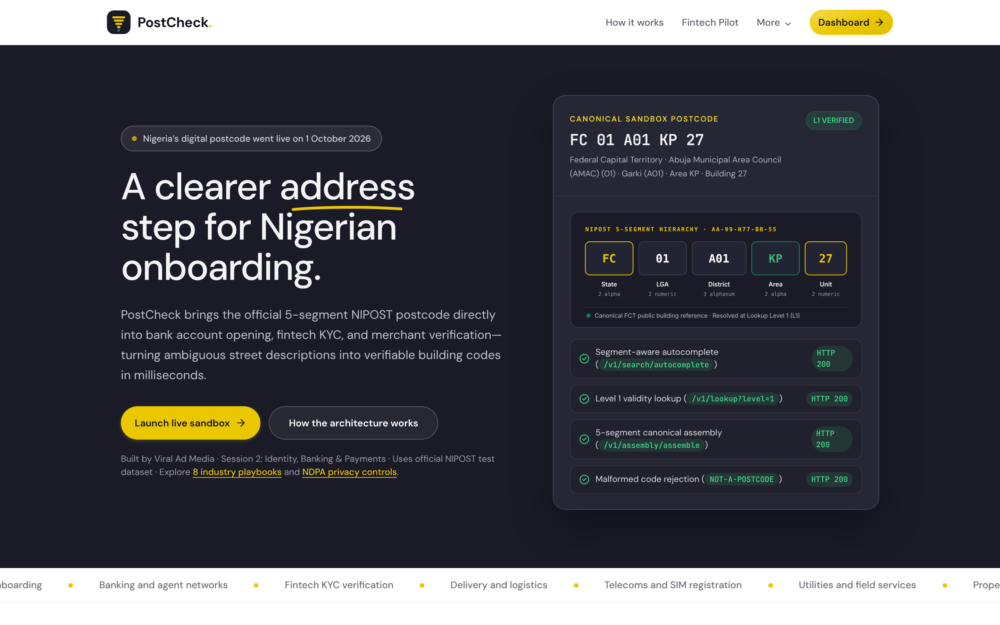
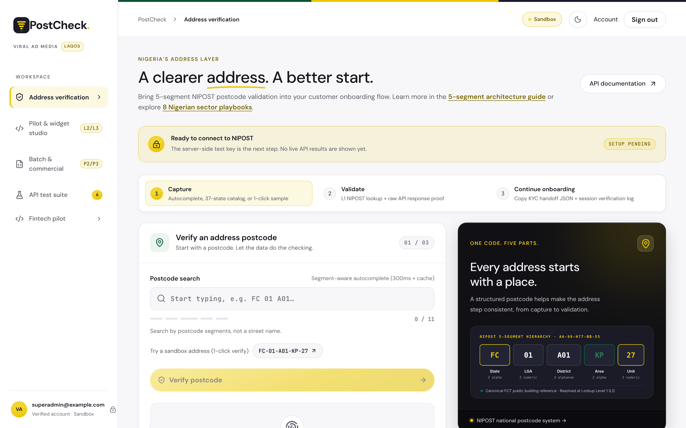
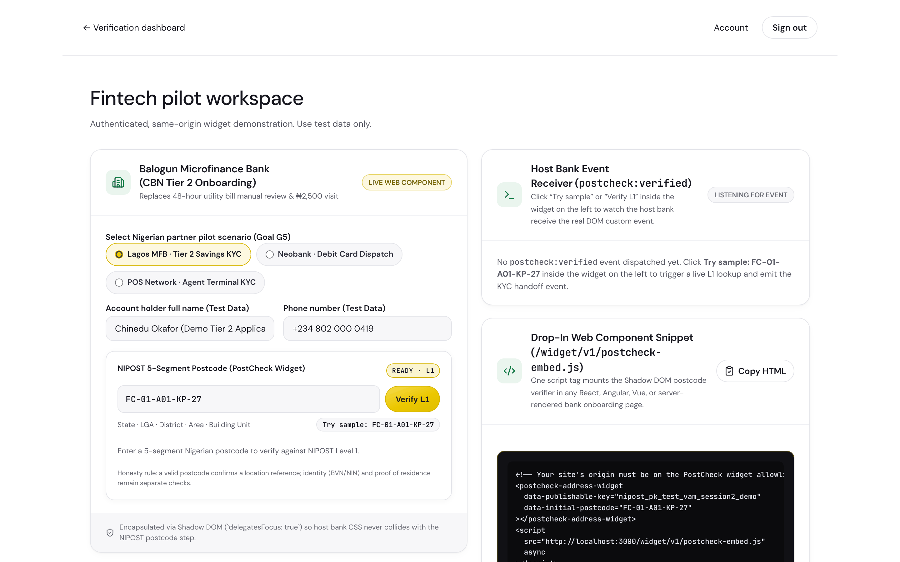
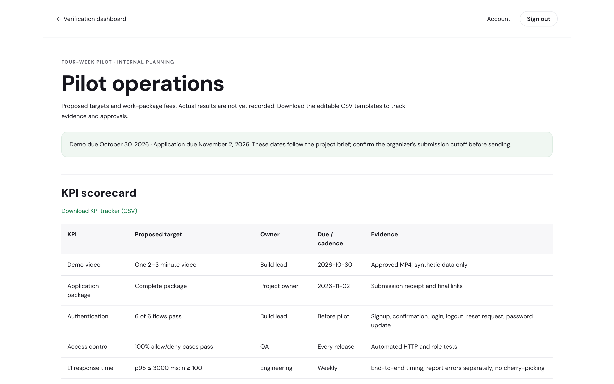
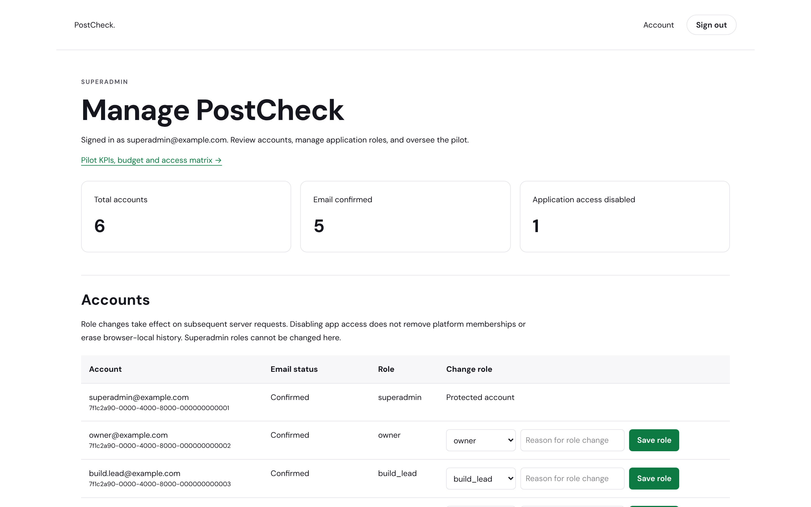

# PostCheck

**Built on Nigeria's Postcode.** PostCheck is a NIPOST postcode address-verification platform for customer onboarding, built with Next.js 16 (App Router), React 19, TypeScript and Neon PostgreSQL and Better Auth.

Live demo: **https://postcheck-nine.vercel.app**



PostCheck brings Nigeria's national digital postcode into account opening, fintech KYC and merchant verification: segment-aware autocomplete (`FR-1`), 1-click sample (`FR-2`), live 37-state reference catalog (`FR-3`), 5-segment assembly and disassembly (`FR-4`), Level 1 (L1) validity lookup with decoded segment chips (`FR-5`), raw API proof viewer (`FR-6`), distinct error and rate-limit states (`FR-7`), 1-click KYC JSON handoff (`FR-8`), mock account-opening flow (`FR-9`), session verification log (`FR-10`), batch backbook audit (`FR-11`) and a 4-check live staging acceptance suite (`FR-12`).

> **Honesty rule:** a valid postcode confirms a structured location reference. It does not prove who lives there. Identity verification (BVN/NIN) and proof of residence remain separate checks.

---

## Screenshots

> Captured from a local production build. The dashboard shows **Setup pending** because no NIPOST test key was configured for the capture, and the admin console uses placeholder `example.com` accounts. No API responses were faked.

### Address verification workspace (`/dashboard`)

Signed-in workspace: capture a postcode with segment-aware autocomplete or the sandbox sample, run an L1 lookup, then hand off KYC JSON.



### Fintech pilot and embeddable widget (`/dashboard/pilot`)

The `<postcheck-address-widget>` Shadow DOM web component inside a mock bank onboarding form, with the host page's `postcheck:verified` event receiver and the drop-in embed snippet.



### Pilot operations (`/dashboard/operations`, staff roles)

Proposed KPIs, budget (owner and superadmin only), access matrix and acceptance checklist, each exportable as CSV.



### Superadmin console (`/dashboard/admin`)

Account directory, role changes with a required reason, and the role-change audit log.



---

## Routes

| Route | Access | Description |
| --- | --- | --- |
| `/` | Public | Marketing home (programme overview) |
| `/overview` | Public | Programme alignment, 4 evaluation criteria (25% each) + NDPA pass/fail gate, showcase schedule and FAQ |
| `/how-it-works` | Public | 5-segment postcode anatomy (`FC-01-A01-KP-27`), 3-step verification proxy workflow and L1–L5 lookup comparison |
| `/sectors` | Public | Before/after onboarding comparison and playbooks for all 8 national priority sectors |
| `/pilot` | Public | Fintech and microfinance pilot plan and widget overview |
| `/privacy` | Public | Nigeria Data Protection Act (NDPA) 2023 safeguards, verification scope and accessibility |
| `/login`, `/signup`, `/forgot-password`, `/reset-password`, `/resend-confirmation` | Public | Better Auth email/password flows (see [docs/AUTHENTICATION.md](docs/AUTHENTICATION.md)) |
| `/dashboard` | Signed in | Address verification workspace and 4-check live acceptance runner (`API test suite`) |
| `/dashboard/pilot` | Signed in | Live `<postcheck-address-widget>` sandbox with KYC handoff event viewer |
| `/dashboard/account` | Signed in | Account details and sign-out |
| `/dashboard/operations` | Staff roles | Pilot KPIs, budget (owner/superadmin only), access matrix and CSV exports |
| `/dashboard/admin` | Superadmin | Account directory, role changes and role audit log |
| `/widget/v1/postcheck-embed.js` | Public script | Self-contained Shadow DOM custom element emitting `postcheck:verified` KYC handoff events |
| `/api/postcode` | Signed in (verifying roles) | Server-only proxy to `https://api.postcode.gov.ng`: forces `level=1`, 10s timeout, secret redaction |
| `/api/widget` | Allowlisted origins | Anonymous L1 lookup for the embed widget; CORS limited to `POSTCHECK_WIDGET_ORIGINS`, rate limited per client |
| `/api/operations/[report]` | Staff roles | CSV exports (`kpis`, `budget`, `access`, `acceptance`) |
| `/sitemap.xml`, `/robots.txt` | Public | Generated from `app/sitemap.ts` and `app/robots.ts` (private routes and `/api/` disallowed) |
| `/llms.txt` | Public | Machine-readable documentation index for AI agents |

---

## Authentication and roles

Better Auth covers signup, email confirmation, login, resend confirmation, password recovery, account details and sign-out. Protected routes validate sessions against Neon on the server; cookie claims are never trusted. Configure a verified email sender before inviting users; see [docs/AUTHENTICATION.md](docs/AUTHENTICATION.md).

Application roles live in the server-controlled Neon `user.role` column. A missing role means `participant`; an unknown value fails closed as `disabled`.

| Role | Verification / postcode API | Operations + KPI, access and checklist exports | Budget | Admin console |
| --- | --- | --- | --- | --- |
| `superadmin` | Yes | Yes | Yes | Yes |
| `owner` | Yes | Yes | Yes | No |
| `build_lead` | Yes | Yes | No | No |
| `qa` | Yes | Yes | No | No |
| `participant` (default) | Yes | No | No | No |
| `demo_editor` | No | No | No | No |
| `disabled` | No | No | No | No |

The superadmin console uses server-only transactions that recheck administrator access. Every role change requires a reason, appends an audit record, and revokes the target account’s sessions. Superadmins cannot be created or changed from the UI. See [authentication setup](docs/AUTHENTICATION.md) and [access policy](docs/submission/ACCESS.md).

---

## Embedding the widget on a partner site

1. Add the partner's exact origin (for example `https://onboarding.partnerfintech.ng`) to `POSTCHECK_WIDGET_ORIGINS`, comma-separated, in the hosting environment, then redeploy.
2. On the partner page:

```html
<postcheck-address-widget data-publishable-key="nipost_pk_test_vam_session2_demo"></postcheck-address-widget>
<script src="https://postcheck-nine.vercel.app/widget/v1/postcheck-embed.js" async></script>
<script>
  window.addEventListener('postcheck:verified', (event) => console.log(event.detail));
</script>
```

The script sends lookups to `/api/widget` on the host it was loaded from. Only Level 1 lookups are allowed, at 30 requests per minute per client (best effort, per server instance). The origin check stops other websites' browsers from using the endpoint, but it is not authentication: a non-browser client can set any `Origin` header. Keep this endpoint on the NIPOST test key until partner API keys exist.

---

## Pilot operations and submission pack

See [docs/submission/README.md](docs/submission/README.md) for the application draft, 2:30 recording script, proposed KPIs and fees, and release checklist. Approved staff see the same material at `/dashboard/operations`. These are proposals, not achieved results or approved fees.

---

## Stack & Engineering Highlights

- **Next.js 16 App Router + React 19 + TypeScript** (`strict: true`, `reactStrictMode: true`, `poweredByHeader: false`, `productionBrowserSourceMaps: false`)
- **Official NIPOST Pitch Aesthetic**: Styled to match `https://pitch.postcode.gov.ng/` using `Syne` and `JetBrains Mono` (`next/font/google`), warm alabaster/coal surfaces, NIPOST Gold (`#EBC700`), and Nigerian Green (`#008753`) with zero flash-of-wrong-theme (`light` / `dark` persistence)
- **Lightweight Accessible Primitives**: Semantic `components/ui/*` primitives (`Button`, `Badge`, `Card`, `Alert`, `Input`, `Label`, `Separator`, `Tabs`, `Collapsible`, `Tooltip`) engineered without heavy client bundle overhead
- **SEO & Structured Data**: Unique `<title>`, `<meta name="description">`, `<link rel="canonical">`, OpenGraph/Twitter social cards (`/og-image.png`), visible `<nav aria-label="Breadcrumb">`, single `<h1>` per route, and JSON-LD schemas (`LocalBusiness`, `WebApplication`, `BreadcrumbList`, and `FAQPage`)
- **NDPA Data Minimization**: Queries NIPOST Lookup Level 1 (`L1`) exclusively—no customer PII, no commercial credits consumed, and no building GPS point geometry (`L5`) requested

---

## Run locally

Use **Node.js 22.13+** (Node 22 LTS recommended) and `npm`.

1. Open a terminal in the `postcheck` folder and run:

```bash
npm ci
cp .env.example .env.local
npm run dev
```

*(On Windows PowerShell, use `Copy-Item .env.example .env.local` instead of `cp`.)*

2. Open `.env.local` and set `NIPOST_API_KEY` to your NIPOST test secret (`nipost_test_...`).
   - Do not add quotes unless needed.
   - **Never** use a `NEXT_PUBLIC_` prefix.
   - Restart the development server after changing environment variables.
3. Open [http://localhost:3000](http://localhost:3000). The verification tools are at `/dashboard` and need a confirmed Better Auth account, so set the database, authentication and SMTP variables in `.env.local`.

Without a configured test key, the workspace displays **Setup pending** and never fabricates API responses.

---

## Four Live Acceptance Checks

Open **API test suite → Run all four checks** in the browser UI and click **Export evidence** to download `postcheck-staging-evidence.json`, or run the CLI suite directly:

```bash
npm run test:staging
```

This reads `.env.local`, executes all four live calls against `https://api.postcode.gov.ng`, and writes `staging-evidence.json`. It exits with code `0` only when all `4 / 4` checks pass.

| # | Check | Upstream Request | Pass Condition |
| --- | --- | --- | --- |
| `01` | **Postcode autocomplete** | `GET /v1/search/autocomplete?q=FC01A01KP` | HTTP 200 with structured `suggestions` array and valid `segment` metadata from the NIPOST sandbox |
| `02` | **L1 postcode lookup** | `GET /v1/lookup?code=FC-01-A01-KP-27&level=1` | HTTP 200 with `valid: true` or canonical `status: "not_found"` for an unseeded sandbox building unit |
| `03` | **Assembly validation** | `POST /v1/assembly/assemble` (`FC` / `01` / `A01` / `KP` / `27`) | HTTP 200 with `postcode: "FC-01-A01-KP-27"` |
| `04` | **Bad-postcode handling** | `GET /v1/lookup?code=NOT-A-POSTCODE&level=1` | Upstream rejection (`status: "invalid"` with `valid: false`, or HTTP `400`/`404`/`422` validation error) |

### Important NIPOST Gateway Details

- **Gateway URL**: `https://api.postcode.gov.ng` (the `nipost_test_*` key selects the sandbox dataset via the `X-API-Key` header).
- **Test-Key Isolation**: Only server-side keys starting with `nipost_test_` are accepted. Live keys (`nipost_live_*`) and publishable keys (`nipost_pub_*`) are rejected before any network call is made.
- **Locked to Level 1 (L1)**: Every lookup explicitly requests `level=1` regardless of client input.
- **Negative Test Integrity**: Authentication failures (`401`/`403`), rate limits (`429`), upstream `5xx` errors, timeouts, and malformed payloads never count as a passed negative test.

---

## Verify & Build

Run the unit test suite, TypeScript compiler check, and production build:

```bash
npm test
npm run typecheck
npm run build
npm run test:auth-http
```

- `npm test` runs the unit tests in `tests/*.test.mjs` covering key validation, L1 enforcement, secret redaction, timeout/abort handling, segment autocomplete helpers, negative-test guards, `/v1/assembly/disassemble`, `/v1/reference/*` catalog validation, `/v1/search/nearby`, `postcheck.kyc.handoff.v1` payload formatting, batch backbook classification, Phase 2 L1/L2/L3 credit & origin-allowlist guards, and Phase 3 commercial billing & signed webhook payloads.
- `npm run typecheck` runs `tsc --noEmit`.
- `npm run build` compiles and prerenders all static pages and discovery files with browser source maps disabled.
- `npm run test:auth-http` checks signed-out and role-based HTTP access to protected routes.

---

## Deployment

PostCheck is a standard Next.js Node.js application:

```bash
npm ci
npm run build
npm start
```

- **Vercel / Node hosting**: Import the repository, keep the Next.js preset, and set:
  - `NIPOST_API_KEY` (server-only NIPOST test key, never `NEXT_PUBLIC_`)
  - `NEXT_PUBLIC_SUPABASE_URL` and `NEXT_PUBLIC_SUPABASE_PUBLISHABLE_KEY` (publishable key only, never service-role)
  - `NEXT_PUBLIC_SITE_URL` (canonical site URL used in auth emails and metadata)
  - `POSTCHECK_WIDGET_ORIGINS` (partner origins allowed to call `/api/widget`)
- **Git Hygiene**: Never commit `.env.local`, `staging-evidence.json`, `node_modules`, or `.next` (all excluded in `.gitignore`).

---

## Project Layout

- `app/layout.tsx` — Root HTML shell, `Syne` + `JetBrains Mono` fonts, theme initialization script, and global OpenGraph/Twitter metadata
- `app/(marketing)/page.tsx` — Public home page (`/`) with `LocalBusiness`, `WebApplication`, and `BreadcrumbList` JSON-LD schemas
- `components/postcode-workspace.tsx` — Interactive postcode verification and 4-check staging test suite client component
- `components/marketing-shell.tsx` — Server-rendered header, breadcrumb bar, JSON-LD injector, and footer for static pages
- `components/theme-toggle.tsx` — Lightweight client leaf button for light/dark theme switching
- `app/(marketing)/overview/page.tsx` — Static programme overview & FAQ page (`/overview`)
- `app/(marketing)/how-it-works/page.tsx` — Static 5-segment postcode & L1–L5 architecture page (`/how-it-works`)
- `app/(marketing)/sectors/page.tsx` — Static 8-sector industry playbooks page (`/sectors`)
- `app/(marketing)/privacy/page.tsx` — Static NDPA compliance & accessibility page (`/privacy`)
- `app/api/postcode/route.ts` — Server-only Next.js Route Handler boundary (`/api/postcode`)
- `app/api/widget/route.ts` & `lib/widget.ts` — Public widget endpoint, origin allowlist and rate limiter
- `app/api/operations/[report]/route.ts` & `lib/pilot-plan.ts` — Staff CSV exports and pilot plan data
- `app/(protected)/dashboard/*` — Signed-in workspace, pilot, account, operations and admin pages
- `app/(auth)/*`, `app/auth/*` & `lib/auth/*` — Better Auth pages, handlers and server session validation
- `lib/access.ts` — Role parsing and permission checks
- `migrations/` — Neon authentication and audit schema; `supabase/` retains historical rollback reference
- `public/widget/v1/postcheck-embed.js` — Embeddable `<postcheck-address-widget>` custom element
- `app/sitemap.ts` & `app/robots.ts` — Static `/sitemap.xml` and `/robots.txt` generators
- `public/llms.txt` — LLM documentation index (`/llms.txt`)
- `public/og-image.png`, `public/icon.svg`, `public/images/*.svg` — Social card, brand icon, and architectural diagrams
- `lib/nipost.ts` — NIPOST API client, credential guard, secret redaction, and 4-check suite runner
- `lib/postcode.ts` — Shared segment constants (`FC-01-A01-KP-27`) and segment-aware query helpers
- `lib/seo.ts` — Canonical metadata builder and JSON-LD schema generators
- `scripts/check-staging.mjs` — CLI runner for the 4-check live NIPOST staging suite
- `tests/*.test.mjs` — Node test runner suites (NIPOST client, auth flow, roles, widget access)
- `docs/screenshots/` — README screenshots
- `docs/DEMO.md` — Demo walkthrough and 2–3 minute showcase script
- `docs/SESSION2-SUBMISSION.md` — Ready-to-paste Session 2 application copy, deployment checklist, video script, and judges Q&A prep

---

## PRD Milestones & Roadmap (Phase 1 → Phase 3)

### Session 2 Milestone Schedule

| Date | Milestone | Status |
| --- | --- | --- |
| **Mon 19 Oct 2026** | Test key connected; first L1 verification passing; API proof captured | **Done** |
| **Fri 23 Oct 2026** | Full flow end-to-end including Continue onboarding (`FR-9`) and verification log (`FR-10`) | **Built** |
| **Tue 27 Oct 2026** | Public demo URL stable (postcheck-nine.vercel.app) | **Deployed** |
| **Fri 30 Oct 2026** | Demo video recorded (2–3 min: problem → flow → bank view → close) | Pending |
| **Mon 2 Nov 2026** | Session 2 application submitted (shortlist closes Tue 3 Nov) | Target |
| **Fri 6 Nov 2026** | Session 2 live showcase (5-min demo + 5-min Q&A) | Target |

### Phase 2 (Post-KYB) & Phase 3 (Commercial) Roadmap

- **Phase 2 — Post-KYB Approval**:
  - Live API keys (`nipost_live_*`), commercial `L2` lookups (administrative hierarchy + recent house address string) and `L3` lookups (building use status: Residential / Commercial / Public) where customer use cases justify credit consumption.
  - Publishable key (`nipost_pk_*`) + official NIPOST widget embed for customer-facing checkout/onboarding pages with strict origin allowlisting.
  - Pilot integrations with design-partner Nigerian fintechs and microfinance banks.
- **Phase 3 — Commercial Scale**:
  - Per-verification billing, usage dashboard, signed webhooks, and high-throughput batch API for enterprise back-book audits.

---

## Official References

- [Built on Nigeria's Postcode Pitch Portal](https://pitch.postcode.gov.ng/)
- [NIPOST Postcode API Documentation](https://docs.postcode.gov.ng/)
- [NIPOST OpenAPI Specification](https://docs.postcode.gov.ng/api-reference/openapi.yaml)
